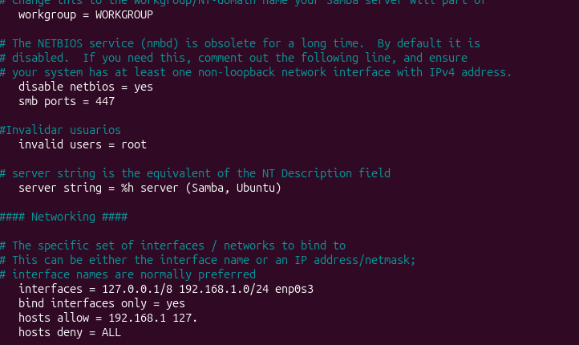
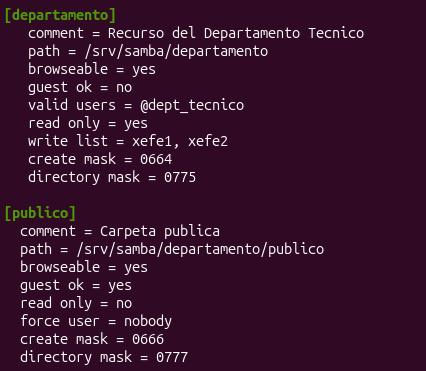

# 🛡️ Bastionado y Securización de Servicio Samba en Debian 12

Este proyecto documenta el laboratorio práctico de despliegue, bastionado (*hardening*) y resolución de compatibilidad para el servicio de compartición de archivos **Samba** sobre **Debian 12**, probado frente a clientes **Windows 10/11**.

---

## 📐 Arquitectura del Sistema

* **Servidor (Debian 12):**
  * Interfaz Interna (`enp0s3`): `192.168.1.20/24`
  * Interfaz Local (`lo`): `127.0.0.1/8`
* **Cliente:** Windows 10/11 VM (`192.168.1.0/24`)
* **Servicios / Cortafuegos:** Samba, `iptables`

---

## 🔒 Directivas de Securización Aplicadas (`[global]`)

1. **Puerto No Estándar (TCP 447):** Desactivación completa de servicios NetBIOS (`disable netbios = yes`) y cambio del puerto predeterminado 445 a **447/TCP**.
2. **Bloqueo Explícito de Root:** Prohibición absoluta de autenticación para el superusuario (`invalid users = root`).
3. **Control de Acceso por Red:** Acceso restringido exclusivamente a la subred `192.168.1.0/24` e interfaz local (`hosts allow = 192.168.1. 127.`, `hosts deny = ALL`).


*Figura 1: Parámetros de bastionado global en /etc/samba/smb.conf.*

---

## ⚡ Verificación de Sockets y Escucha del Servicio

Comprobación mediante `sudo ss -tulpn | grep smbd` confirmando que el demonio `smbd` escucha exclusivamente sobre el puerto **447** en la IP local y de red interna:


*Figura 2: Verificación de sockets activos en el puerto TCP 447.*

---

## 📁 Configuración de Recursos Compartidos y Permisos

Definición de parámetros para los recursos `[departamento]` (acceso restringido a grupo técnico con permisos diferenciados) y `[publico]` (acceso invitado anónimo con permisos totales):


*Figura 3: Configuración de los recursos [departamento] y [publico] en smb.conf.*

---

## 🔀 Redirección NAT para Compatibilidad con Clientes Windows

Dado que el cliente SMB del Explorador de Windows requiere el puerto 445 de forma nativa y no permite especificar puertos en sintaxis UNC, se implementó una regla de redirección a nivel de kernel en el servidor Debian mediante `iptables`:

```bash
sudo iptables -t nat -A PREROUTING -i enp0s3 -p tcp --dport 445 -j REDIRECT --to-ports 447
